# TRPG ledger: what goes in, what comes out, and how it could fail

*Version 1.4.1, 25 November 2026 (only the paper's statement of AI use changed from 1.4.0). Version 1.4.0: five rules and one bet; a short start phase driven by the stiffness of space kept as the alternative start, decided by the tilt of the first ripples (`analysis/start_phase_starobinsky_2026-11-19.py`); no particle-physics number changed. Values as recalibrated to PDG 2026 and JUNO 2026 in v1.3.3 by `analysis/recalibrate_to_2026_values_2026-11-18.py`. `python analysis/input_ledger_2026-11-18.py` reruns the main-line count and the break tests for the results that move it (tau mass, down quark, lightest neutrino mass, Higgs mass), plus the strong-force strength and the JUNO lead; `analysis/input_ledger_2026-11-19.py` gives the count with the alternative start. It does not re-check the other derived rows. Those are standard results or come from the scripts named in the paper and the README (for example `analysis/pairing_gap_scan_2026-11-14.py` for the pairing gap and `analysis/neutrino_perspectives_2026-11-14.py` for θ₁₂ and the CP phase).*

This page answers the first three questions a careful reader asks of any unified theory. What was taken from measurement? What was chosen with today's data in view? And what does the framework say that has not been measured yet? Every quantity appears once, with one label. Nothing is counted as established until its measurement returns.

**Labels.**
**Input**: taken from measurement.
**Fitted**: a choice made with today's data in view.
**Derived**: follows from the rules plus inputs, and agrees with a measurement already made.
**Predicted**: follows from the rules plus inputs, but the measurement that decides it has not returned. It is not 100% until that measurement returns.
**Lead**: a promising relation with a named missing rule. It is not part of the core.
**Effective**: an effective number of known physics (like the constants of the nuclear-mass formula), counted on neither side.

The last column asks whether the result is **unique to TRPG**. "Shared" means another published idea gives the same number, and that idea is credited.

---

## 1. The headline prediction: neutrino masses

If one number decides TRPG first, it is this one.

| | TRPG | Status today | Decided by |
|---|---|---|---|
| Ordering | **normal** | weakly preferred by data | JUNO (3σ expected after about 6.5 years of running, early 2030s), with DUNE and Hyper-Kamiokande |
| Masses | **m₁ = 0.36 meV, m₂ = 8.6 to 8.7 meV, m₃ = 50.1 to 50.3 meV** (JUNO 2026 splittings to the NuFIT 6.0 global fit) | not measured | cosmology and JUNO together |
| Sum | **0.0591 to 0.0594 eV** | below the cosmological limit (DESI 2025: under about 0.064 eV) | DESI final data, Euclid, next-generation CMB |

**Where it comes from.** The 45° rule that gives the tau mass, applied to the neutrinos with one negative root, plus the two measured mass splittings. Nothing else enters.

**Credit and uniqueness.** The same relation for neutrinos was proposed by Brannen (2006), building on Koide (1983). TRPG supplies a reason for it, the family symmetry together with maximum uncertainty between self and relationship, but not a different number. So this test cannot single out TRPG from Brannen's proposal. It can falsify both.

**TRPG is false if** neutrinos turn out to have inverted ordering, or the mass sum is measured clearly different from 0.059 eV (any value the measurement excludes 0.0591–0.0594 eV at 3σ).

**A companion test (a lead, under strain).** If the middle-to-heaviest mass ratio is exactly 3 − 2√2, the small splitting must be 7.37 ± 0.08 × 10⁻⁵ eV² with JUNO's large splitting (2.509 × 10⁻³ eV²). Up to v1.2.2 this read 7.40 ± 0.06, from the global fit's large splitting (2.519 × 10⁻³); the relation has no free number and only that input changed (v1.3.2). JUNO's 2026 result, 7.388 ± 0.078, lies within 0.2σ of both, so the change gained nothing. The ratio (the midpoint of a side of the mass triangle) was proposed when the measured mass ratio was already known, so it is a hint found after the fact. This relation is not part of the core, and it is listed here because it will be decided first.

---

## 2. The count of inputs

Counted like for like, the Standard Model with gravity and cosmology takes **34** free numbers: 3 force strengths, the Higgs value and mass (2), 9 charged-fermion masses, 4 quark-mixing numbers, the strong-CP angle, 3 neutrino masses, 6 neutrino mixing numbers, gravity's strength, dark energy, the dark matter amount, the matter excess, and 2 numbers for the seeds of galaxies.

TRPG removes six of these, two already confirmed and four waiting for a measurement:

| Removed | How | Status |
|---|---|---|
| Tau mass | 45° rule for leptons (Koide, 1983) | **confirmed**: 1776.969 MeV vs 1776.93 ± 0.09 (+0.4σ) |
| Down-quark mass | Cabibbo relation (Gatto, Sartori and Tonin, 1968): strange-to-down mass ratio 19.9 vs 19.8 ± 0.3 from the PDG 2026 masses (sine form; the tangent form fails) | **confirmed** (+0.3σ) |
| Higgs mass | Self-coupling zero at the grain of space (Shaposhnikov and Wetterich, 2010), with the far-side states | **pending**, and under strain: it needs a top mass 3.7σ below today's (PDG 2026), and its pass rests on a 0.5 GeV allowance for the top mass's meaning |
| Lightest neutrino mass | 45° rule with one negative root (Brannen, 2006) | **pending** (Section 1) |
| θ₁₂ given θ₁₃ | TM1 mixing pattern (Xing and Zhou, 2007; Albright and Rodejohann, 2009) | **pending**; 2.3σ from JUNO 2026 (fails at 3σ) |
| Neutrino CP phase | TM1 read as perspectives | **pending**; today's fits lean to 180–215°, against TRPG's 253–292° |

**Version 1.4.0.** The main line follows today's combined CMB and DESI data and keeps the tilt of the first ripples as a measured input, so the count is unchanged from v1.3.3. The alternative start phase (a short stretching driven by the stiffness of space) would turn the tilt into a prediction (saved only if it lands) and make the decay coupling of the far-side weak pairs a required number, since the heat after that start produces them: 33 today instead of 32, still 28 once the tilt lands, with a seventh choice (below).

**The honest count:**

- **32 free numbers today** on the main line (33 with the alternative start, which requires the far-side weak pairs' decay coupling), counting only savings that measurement has already confirmed.
- **28 if every pending measurement agrees** (with the alternative start, the tilt of the first ripples is among them). This is the figure quoted elsewhere as "about 28". It is a ceiling on the saving, not a result.
- **27** if, in addition, the strong coupling lands at 0.1178. That saving counts only once the Higgs mass also lands, because both rest on the same fitted choice of grain.

**Plus six stated choices, made with today's data in view (fitted), and a seventh with the alternative start:**

1. The grain of space is the Planck energy ÷ √2. Five equally natural readings give five factors (`analysis/derive_45_and_sqrt2_2026-11-18.py`). This choice feeds both the strong coupling and the Higgs mass.
2. The weight rule of the far-side weak pairs (meeting energy squared ÷ grain). This is one assumption: the pairs have no direct link to the background value that weighs their coloured partners.
3. The coloured far-side (D) states placed where the strengths cross (4.6 × 10¹³ GeV), with the three strengths taken as equal there. Above that energy they separate again; no placement makes them equal at the grain, so this is a boundary condition inside the bet, not a derivation (`analysis/crossing_vs_grain_2026-11-18.py`).
4. TM1 rather than another mixing pattern. Exact tribimaximal and TM2 are disfavoured by data.
5. The sign pattern of the neutrino roots (−, +, +). The all-positive pattern has no solution with the measured splittings.
6. Maximum uncertainty between self and relationship as the reason for the 45° rule. It is a starting principle, chosen knowing that Koide's relation holds for the charged leptons, and it fails for quarks. The tau mass is therefore "derived" from a principle that was itself chosen with data in view.
7. *(alternative start only)* The Higgs field's coupling to curvature, ξ ≈ 0.06–0.15: at least 0.06 keeps the Higgs safe during the start phase with the measured top mass (Herranen et al., 2014; Espinosa et al., 2015), and 0.12–0.15 keeps the heat after the start low enough for the majoron lead (`analysis/start_phase_starobinsky_2026-11-19.py`).

**Counted on neither side (effective numbers of the strong force):** the containment pressure B = 60 (57–64) MeV/fm³, set from the proton and Delta masses, and the stiffness of the containment field, set from the lattice glueball mass of 1.71–1.73 GeV.

---

## 3. The ledger

### Inputs (taken from measurement): 29 core today (28 once the predicted tilt lands), plus the 4 pending items above while they are pending

| Quantity | Count | Note |
|---|---|---|
| Force strengths | 3 | One is saved if α_s lands at 0.1178 (see above) |
| Gravity's strength | 1 | Tied to the force strengths at the grain; not derived |
| Higgs value (246 GeV) | 1 | Why it settles, and at 246 GeV, is open |
| Lepton scale | 1 | The size of the lepton family |
| Lepton twist | 1 | One number with the electron's mass (0.222222, matches 2/9 but not derived) |
| Quark masses: up, strange, charm, bottom, top | 5 | Up is reached from the measured ratio Q (a check, not a saving) |
| Quark mixing | 4 | |
| Strong-CP angle | 1 | |
| Neutrino mass splittings | 2 | |
| Neutrino mixing numbers that TM1 does not fix | 4 | θ₁₃, θ₂₃ and two Majorana phases |
| Dark energy | 1 | Read as the kept amount of space |
| Dark matter amount | 1 | Read as partly perspective, partly the majoron (a lead) |
| Matter excess | 1 | Allowed, not predicted |
| Seeds of galaxies: size | 1 | With the alternative start it fixes that start's one number (scalaron mass 3.1–3.2 × 10¹³ GeV) |
| Seeds of galaxies: tilt | 1 | measured input on the main line; predicted (0.963) only by the alternative start |
| Decay coupling of the far-side weak pairs (alternative start only; not in the main-line 32) | (1) | required only if the start reheats above 2.4 × 10⁸ GeV; must then exceed about 9 × 10⁻¹² |

### Derived (agrees with a measurement already made)

| Result | TRPG | Measured | What it used | Unique to TRPG? |
|---|---|---|---|---|
| Tau mass | 1776.969 MeV | 1776.93 ± 0.09 | e and μ masses, 45° rule (whose principle is fitted choice 6) | Shared: Koide (1983). TRPG adds the reason |
| Electron, muon, tau together | 3 masses | 0.003% | **two** numbers (scale and twist) plus the 45° rule | Shared (Koide; Foot; Brannen) |
| Down quark (strange-to-down mass ratio) | 19.9 | 19.8 ± 0.3 (PDG 2026 masses) | Cabibbo angle, strange mass | Shared: Gatto, Sartori and Tonin (1968). One relation, counted once: it is the same relation as "Cabibbo angle from the masses" |
| Up quark | 2.03 MeV | 2.16 ± 0.07 | Cabibbo relation and the measured Q from η → 3π | Shared: Leutwyler (1996). A check, not a saving |
| Which forces exist (12 carriers, 8 + 3 + 1) | theorem | as observed | the perspective principle | Shared mathematics: Günaydin and Gürsey (1973); Todorov and Dubois-Violette (2018); Krasnov (2019). TRPG's reading of the matrix as one perspective is its own |
| Charges of a whole generation | exact | as observed | the three-way reading of the matrix (stated, not derived) | Partly: anomaly cancellation is standard |
| One-handed matter, no mirror particles | exact | as observed | the no-gaps rule applied to spin (stated reading) | TRPG's reading |
| Quark charges, given three colours | +2/3, −1/3 | same | anomaly cancellation | No: standard |
| ρ = 1 | exact | 1.0004 ± 0.0002 (with known corrections) | the Higgs pair, nothing extra | No: standard (Veltman, 1977) |
| Colour-neutral proton, neutral atom | exact | as observed | facing-blind part of the matrix | Reached by a second route |
| Containment pressure B | 60 (57–64) MeV/fm³ | 1975 bag fit ≈ 57 | proton and Delta masses | Effective number; second route to the bag model |
| Light bending, radar delay | 1.752″ | 1.75″ | measured G | No: general relativity in optical form |
| Black-hole ringdown | 250 Hz, 4.0 ms | matches GW150914 | measured masses and G | No: general relativity |
| Age of the universe | 13.79 Gyr | 13.79 ± 0.02 | measured expansion inputs | No: standard cosmology from inputs |
| Tau lifetime | 289.7 fs | 290.3 fs | muon lifetime | No: lepton universality |
| At least three generations | theorem | three seen | three placements of one shape | TRPG's reading. "At most three" rests on the nothing-extra rule |

### Predicted (not 100% until the measurement returns)

| Prediction | TRPG | Today | Decided by | Unique to TRPG? |
|---|---|---|---|---|
| **Neutrino ordering, masses, sum** | normal; 0.36, 8.6–8.7, 50.1–50.3 meV; 0.0591–0.0594 eV | consistent; JUNO 2026 favours normal ordering at 2.1σ | JUNO; DESI, Euclid | Shared with Brannen (2006) |
| Strong coupling at the Z | 0.1178 | 0.1180 ± 0.0009 world average; 0.11873 ± 0.00056 most precise lattice (+1.7σ) | lattice at about 0.3% | The number depends on TRPG's far-side states (2.4 × 10⁸ GeV); rests on the fitted grain |
| Higgs mass from the grain | 127.3 ± 1.5 GeV | 125.13 ± 0.11 (1.4σ; 2.1σ without the top-mass allowance); needs top 171.6 vs 172.60 ± 0.27 (3.7σ) | a sharper top mass | No: any extra weak matter at high energy helps the same way |
| θ₁₂ | sin²θ₁₂ = 0.318 | JUNO 2026: 0.3036 ± 0.0064, so TM1 is 2.3σ high (3σ would fail it) | JUNO | Shared: TM1 models |
| Neutrino CP phase | 253–292° | fits lean to 180–215° (weak) | DUNE, Hyper-Kamiokande | Shared in part: TM1 models with this reading |
| Quark triangle angle γ | 64.1–67.6° | about 65° ± 3° (consistent) | LHCb, Belle II | From the lead α = 90°. Shared with the right-unitarity-triangle idea (Antusch, King, Malinsky and Spinrath, 2010) |
| First-row quark-mixing shortfall | shrinks to zero | about 2σ today | neutron and nuclear beta decay, pion beta decay | TRPG's (no fourth generation, no extra states) |
| Quark pairing gap in compact (self-bound strange) stars | 4Δ² − m_s² = 1.7–2.8 × 10⁴ MeV²: about 82–97 MeV at m_s = 100 MeV, 88–109 MeV for a running m_s of 120–140 MeV | not measured (theory spans 50–150) | lattice and effective theory; neutron-star cooling and mergers | TRPG's, given B from the proton |
| Neutrinoless double beta decay | 1.3–4.1 meV (1.8–2.3 if the Majorana phases are zero) | below the limit (28–122 meV) | beyond planned reach (10–20 meV) | Follows from the neutrino masses above |
| Proton decay | none | none seen (> 2.4 × 10³⁴ yr) | Hyper-Kamiokande | Shared with any model without coloured Higgs partners |
| Primordial gravitational waves (alternative start only) | r = 0.0040 ± 0.0003 (main line: none measurable, r ≲ 10⁻¹¹ in the majoron lead) | none seen (r < 0.036) | Simons Observatory (about 0.003), LiteBIRD (about 0.001), early 2030s | Shared: Starobinsky (1980) R² start. On the main line the majoron lead's r below about 10⁻¹¹ holds |
| Tilt of the first ripples (alternative start only) | n_s = 0.9630–0.9636 | disfavoured by combined data, which the main line follows: Planck 0.9638 ± 0.0040 (−0.1σ); Planck + DESI 0.9690 ± 0.0035 (−1.6σ); Planck + ACT + SPT 0.9693 ± 0.0029 (−2.1σ); ACT DR6 + Planck + DESI 0.9743 ± 0.0034 (−3.2σ); Planck + ACT + SPT + DESI 0.9737 ± 0.0025 (−4.2σ) (McDonough and Ferreira, 2025) | CMB alone at higher precision (Simons Observatory); DESI–CMB agreement | Shared: Starobinsky; Mukhanov and Chibisov (1981). The DESI-driven shift comes from a ~2σ DESI–CMB disagreement |
| Flatness, uniform temperature | explained only by the alternative start; measured inputs on the main line | as observed | — | Shared: any start of this kind |
| Tau mass, sharper | 1776.969 MeV | 1776.93 ± 0.09 | Belle II, BESIII | Shared: Koide |
| Unmeasured Higgs couplings (self-couplings 191 GeV and 0.776; HHWW 0.213) | as listed | not measured | HL-LHC, future colliders | No: Standard Model values in TRPG's form. They test bookkeeping |

### Leads (each with one named missing rule; not part of the core)

| Lead | What it gives | What is missing |
|---|---|---|
| Small neutrino splitting (m₂/m₃ = 3 − 2√2) | 7.37 ± 0.08 × 10⁻⁵ eV² (7.40 with the older global fit's large splitting) | a reason for the ratio; JUNO 2026 (7.388 ± 0.078) within 0.2σ |
| Majoron as dark matter | a cold, chargeless wave; no X-ray line | its mass and amount |
| Matter excess | allowed, through non-thermal leptogenesis | one start number |
| Heavy quark masses and mixing (the fold) | all three mixing angles within 19% | a rule for the fold's strength |
| First-rung quark tilt with α = 90° | largest quark tilt (−0.5σ) and γ | fails one rung up |
| Exact right-angled triangle (λ = 1/√20, A = √(2/3), β = 22.5°, γ = 67.5°) | all seven directly measured mixing quantities within 1.6σ (χ² = 6.0 for 7); sin 2β = 1/√2; \|V_ud\| = 0.97467 (+3.1σ, the first-row bet) | the four numbers are chosen, not derived |

---

## 4. TRPG is false if…

Each of these would break the named part. None has returned yet. Dates are the experiments' own published expectations and may slip.

| If this is measured | It breaks | Expected |
|---|---|---|
| Inverted neutrino ordering | the neutrino masses and the 45° rule for neutrinos | JUNO, early 2030s; DUNE, Hyper-Kamiokande, 2030s |
| A neutrino mass sum that excludes 0.0591–0.0594 eV at 3σ | the neutrino masses | DESI final data, Euclid, late 2020s to early 2030s |
| The small splitting more than 3σ from 7.37 ± 0.08 × 10⁻⁵ eV², JUNO's error combined (outside about 7.13–7.62 at JUNO's full precision) | the 3 − 2√2 lead | JUNO, within about 6 years |
| α_s(M_Z) more than 3σ from 0.1178 with a 0.3% lattice result | the far-side weak pairs and the grain choice, and with them the closing of the force strengths | lattice QCD, next few years |
| A top pole mass that puts the Higgs rule more than 3σ off | the Higgs mass from the grain | LHC and HL-LHC top-mass work |
| The neutrino CP phase firmly outside 253–292° | the TM1 perspective reading | DUNE, Hyper-Kamiokande, 2030s |
| sin²θ₁₂ more than 3σ from 0.318 (today 2.3σ) | TM1, and with it the θ₁₂ and CP-phase savings | JUNO, next few years |
| A confirmed shortfall in the first row of the quark-mixing matrix | the far-side reading (D states at 4.6 × 10¹³ GeV keep the row unitary to about 10⁻²³) | beta-decay and pion experiments |
| γ firmly outside 64.1–67.6° | the α = 90° lead | LHCb Upgrade, Belle II |
| A quark pairing gap firmly outside the band 4Δ² − m_s² = 1.7–2.8 × 10⁴ MeV² (82–97 MeV at m_s = 100 MeV), or a compact star clearly above about 2.15 solar masses | containment with B from the proton | theory, timing and merger data (PSR J0952−0607 at 2.35 ± 0.17 is the case to watch) |
| Proton decay of any kind | the nothing-extra rule and the far side | Hyper-Kamiokande, from about 2028 |
| A fourth generation, a new force carrier, mirror families, a second Higgs pair or a coloured spin-0 particle | the nothing-extra rule | any collider |
| No primordial gravitational waves at r ≈ 0.004 once experiments reach about 0.001 | the alternative start phase | Simons Observatory, LiteBIRD, early 2030s |
| A CMB-only tilt above about 0.972 at 3σ, or DESI and the CMB brought into agreement at the higher value | the alternative start phase | Simons Observatory, ACT, SPT, DESI |
| Primordial gravitational waves far above 10⁻¹¹ under the cold start | the majoron lead with the main line's cold start | Simons Observatory, LiteBIRD |
| Dark matter that feels the weak force | the majoron lead | direct-detection experiments |
| Neutrinos proven to be Dirac particles | the Higgs-free neutrino mass and 0νββ | neutrinoless double beta decay searches |
| The tau mass measured firmly away from 1776.969 MeV | the 45° rule for leptons | Belle II, BESIII |

---

## 5. The derivation tree

The figure `figures/derivation_tree.png` shows the same chain as a picture. Rules are at the top, measured inputs at the side, and outputs at the bottom, coloured by label.

```mermaid
flowchart TD
  R1["Rule: one full medium,<br/>seen one perspective at a time"]
  R2["Rule: containment<br/>(push balances pull)"]
  R3["Rule: maximum uncertainty<br/>between self and relationship"]
  R4["Rule: nothing extra"]
  R5["Rule: smooth start<br/>(stretching phase = alternative)"]
  R5 --> RS["ALTERNATIVE ONLY: r = 0.0040,<br/>tilt n_s = 0.963 (disfavoured with DESI)"]
  BET["Bet: the far side of the<br/>relationship matrix is real"]
  IN["28 measured inputs<br/>(+4 pending; +1 today until the tilt lands)"]
  FIT["3 fitted choices<br/>(grain = Planck/√2, far-side weight rule,<br/>equal strengths at the crossing)"]
  FIT2["3 fitted choices<br/>(maximum uncertainty, TM1, neutrino root signs)"]

  R1 --> OCT["Octonions: 3 colours,<br/>strong force"]
  R1 --> FORCES["Which forces exist:<br/>8 + 3 + 1 (theorem)"]
  R1 --> GEN["Generation charges,<br/>one-handed matter (stated readings)"]
  R1 --> GRAV["Form of gravity<br/>(G is an input)"]
  R2 --> BAG["B from proton + Delta<br/>(effective)"]
  BAG --> GAP["PREDICTED: pairing gap band (82–97 MeV at m_s = 100)"]
  R3 --> K45["45° rule for leptons"]
  K45 --> TAU["DERIVED: tau mass (Koide)"]
  K45 --> NU["PREDICTED: neutrino masses,<br/>normal ordering, sum 0.059 eV"]
  R1 --> TM1["TM1 as perspectives"]
  TM1 --> DCP["PREDICTED: sin²θ12 = 0.318, CP phase 253–292°"]
  BET --> MMG["Far-side weak pairs at 2.4×10⁸ GeV"]
  FIT --> MMG
  MMG --> AS["PREDICTED: α_s = 0.1178"]
  MMG --> MH["PREDICTED: Higgs 127.3 GeV"]
  R4 --> PD["PREDICTED: no proton decay"]
  IN --> TAU
  IN --> NU
  IN --> AS
  IN --> MH
  IN --> GAP
  IN --> DCP
  FIT2 --> K45
  FIT2 --> TM1
  FIT2 --> NU
```

---

## 6. Tests set after an earlier attempt failed

An audit on 18 November 2026 asked of every test: was a number, a form or a model chosen after an earlier attempt missed? The full list is in Appendix A.6 of the paper. In short:

| Test | What was chosen after the fact | Consequence |
|---|---|---|
| Strong coupling 0.1178 | the grain, best of five readings (the plain Planck energy also passed and gives 0.1196) | fitted choice 1; only later measurements test it |
| Far-side weak pairs at 2.4 × 10⁸ GeV | the weight rule, written after the strengths required 2.2 × 10⁸ | fitted choice 2 |
| Strengths equal at the crossing | the boundary condition, added after equality at the grain failed | fitted choice 3 |
| Compact-star masses | the pairing gap, introduced after the unpaired stars failed, and its band re-set as the model changed (70–90, 80–100, 82–97, 88–109 MeV) | the star masses are not evidence; the gap is tested only by an independent determination |
| Higgs mass | the rule, the only rule borrowed on 17 November that set a number and passed (three others failed); its pass also rests on a 0.5 GeV top-mass allowance (2.1σ without it) | pending, under strain |
| TM1 and the root signs | chosen after other patterns failed | fitted choices 4 and 5 |
| 45° rule for leptons | the principle, adopted knowing Koide's relation | fitted choice 6 |
| Small neutrino splitting | the ratio 3 − 2√2, proposed when the measured mass ratio was already known | a hint |
| Down quark | the sine form of the Cabibbo relation (the tangent form fails at −2.7σ) | a choice of form |
| Up quark | the decay value of Q (0.4σ with Q's error included; the lattice value gives 2.0σ) | the check stands or falls with Q |

## 6a. Tests run after 18 November 2026 that failed

Rechecked with independent code (`analysis/farside_charge_rule_2026-11-25.py`, `analysis/quark_triangle_and_press_2026-11-25.py`, `analysis/cfl_gap_and_tides_2026-11-25.py`, `analysis/refinement_checks_2026-11-25.py`). The same recheck confirmed the pairing-gap band of the ledger above: at B = 60.1 MeV/fm³ the heaviest star is 2.00–2.13 solar masses and Λ₁.₄ = 459–575. None is part of the framework. The full list is Appendix A.7 of the paper.

| Test | Result |
|---|---|
| Six-step (ℤ₆) charge giving the far-side weight rule | gives 2.45 × 10⁸ GeV, but is anomalous (colour and weak sums 3 and 15); no ℤ_N up to N = 18 works; the weight rule stays fitted choice 2 |
| Three generations from that charge | no number from one to five passes; six passes but ends asymptotic freedom |
| Walls removed by gravity at Φ⁵ | the timing works, but a charge broken by gravity protects nothing |
| Very light majoron dark matter without inflation (f = 2.1 × 10¹⁶ GeV) | one starting angle cannot be chosen without inflation; needs gravity breaking near the 37th power; supermassive black hole spins largely exclude the mass range |
| Pairing gap 90–125 MeV | Λ₁.₄ = 652–1124, above GW170817's 580; the two-family picture is Drago, Lavagno and Pagliara (2014) |
| Matter excess with the Dirac link aligned to the neutrinos | decay asymmetry vanishes; rests on a hand-set starting rotation |
| Dark energy ρ = B^3/2^ / [3 (16π²)² M²] | 2.13–2.23 meV, but the closest of ten forms tried |
| 3 × 3 down-quark matrix with set weights | χ² = 11.5 (26 at the Z mass) |
| Simple fractions for the seeds' tilt | no equation behind them |
| Higgs mass as 246/2 (self-coupling 1/8) | the self-coupling is 1/8 near 182 GeV, not at v (0.1192 there); 1/8 at v needs m_H = 127.9 GeV |
| Integer loop rungs ln(m_wall/m)/ln(16π²) | random masses cluster as well 81% of the time |

## 7. What changed in this version

**Version 1.4.1 (25 November 2026).** The paper's Acknowledgements now state fully how AI assistants were used. Nothing in this ledger changed.

**Version 1.4.0 (25 November 2026).** The framework is restated as five rules and one bet: one matrix of relationships read in three roles (held states on the diagonal, pulls as links between them, the Higgs as the link across each state, and space and time as the geometry of the relationships); balance of pull and resistance; maximum uncertainty for the leptons; nothing extra; and a smooth start. A short stretching driven by the stiffness of space (Starobinsky, 1980) is kept as the alternative start: it predicts r = 0.0040 ± 0.0003 and n_s = 0.963, which agrees with the CMB alone but is 3.2–4.2σ low once DESI is combined, so the main line follows the combined data and keeps the tilt as a measured input. With the alternative the count would be 33 today and seven choices (the far-side decay coupling and ξ); on the main line it stays 32 and six. Also added: the exact right-angled quark triangle as a lead (row above), a tested charge rule for the far-side weight that does not hold, Section 6a, and in the paper Appendix A.8, where each open problem stands. No particle-physics number changed.

**Version 1.3.3 (18 November 2026).** Values recalibrated to PDG 2026 and JUNO 2026 (`analysis/recalibrate_to_2026_values_2026-11-18.py`). The Higgs rule now needs a top mass 3.7σ below today's (was 3.2σ), and its pass rests on the top-mass allowance. With JUNO's splittings m₂ is 8.6 meV and the sum 0.0591 eV, so both are now given as ranges. The small splitting's move from 7.40 to 7.37 is explained, and its fail band is now a 3σ test with both errors combined (about 7.13–7.62 at JUNO's full precision; the older bands were one standard deviation wide). The down quark is compared with the measured masses (19.8 ± 0.3) instead of an unsourced 20.4. Section 6 above is new.

**Version 1.2.2.**

Nothing in the framework changed. This page gathers bookkeeping that was spread across the paper. In gathering it, four labels were tightened:

- The input count is stated as a range, **32 today and 28 if every pending measurement agrees**, instead of a single "about 28".
- The lepton masses come from **two** numbers (scale and twist) plus the 45° rule, not from one.
- "Cabibbo angle from the masses" and "down quark from the Cabibbo angle" are **one relation**, counted once.
- The neutrino masses are **shared** with Brannen's 2006 proposal, and that credit is now stated beside them.
