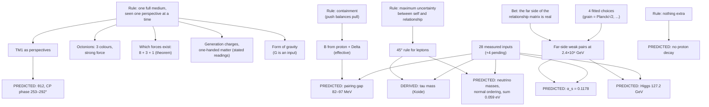

# TRPG ledger: what goes in, what comes out, and how it could fail

*Version 1.2.2, 18 November 2026. Rerun every number here with `python analysis/input_ledger_2026-11-18.py`.*

This page answers the first three questions a careful reader asks of any unified theory. What was taken from measurement? What was chosen with today's data in view? And what does the framework say that has not been measured yet? Every quantity appears once, with one label. Nothing is counted as established until its measurement returns.

**Labels.**
**Input**: taken from measurement.
**Fitted**: a choice made with today's data in view.
**Derived**: follows from the rules plus inputs, and agrees with a measurement already made.
**Predicted**: follows from the rules plus inputs, but the measurement that decides it has not returned. It is not 100% until that measurement returns.
**Lead**: a promising relation with a named missing rule. It is not part of the core.
**Effective**: an effective number of known physics (like the constants of the nuclear-mass formula), counted on neither side.

The last column asks whether the result is **unique to TRPG**. "Shared" means another published idea gives the same number, and that idea is credited.

---

## 1. The headline prediction: neutrino masses

If one number decides TRPG first, it is this one.

| | TRPG | Status today | Decided by |
|---|---|---|---|
| Ordering | **normal** | weakly preferred by data | JUNO (3σ expected after about 6.5 years of running, early 2030s), with DUNE and Hyper-Kamiokande |
| Masses | **m₁ = 0.36 meV, m₂ = 8.7 meV, m₃ = 50.1 to 50.3 meV** | not measured | cosmology and JUNO together |
| Sum | **0.0592 to 0.0594 eV** | below the cosmological limit (DESI 2025: under about 0.064 eV) | DESI final data, Euclid, next-generation CMB |

**Where it comes from.** The 45° rule that gives the tau mass, applied to the neutrinos with one negative root, plus the two measured mass splittings. Nothing else enters.

**Credit and uniqueness.** The same relation for neutrinos was proposed by Brannen (2006), building on Koide (1983). TRPG supplies a reason for it, the family symmetry together with maximum uncertainty between self and relationship, but not a different number. So this test cannot single out TRPG from Brannen's proposal. It can falsify both.

**TRPG is false if** neutrinos turn out to have inverted ordering, or the mass sum is measured clearly outside 0.058 to 0.07 eV.

**A companion test (a lead, under strain).** If the middle-to-heaviest mass ratio is exactly 3 − 2√2, the small splitting must be 7.40 ± 0.06 × 10⁻⁵ eV². Today's global fits with JUNO's first data give 7.48 to 7.53, which is +0.7 to +1.1σ away. At JUNO's design precision, today's central value would be about 3 to 5σ away. This relation is not part of the core, and it is listed here because it will be decided first.

---

## 2. The count of inputs

Counted like for like, the Standard Model with gravity and cosmology takes **34** free numbers: 3 force strengths, the Higgs value and mass (2), 9 charged-fermion masses, 4 quark-mixing numbers, the strong-CP angle, 3 neutrino masses, 6 neutrino mixing numbers, gravity's strength, dark energy, the dark matter amount, the matter excess, and 2 numbers for the seeds of galaxies.

TRPG removes six of these, two already confirmed and four waiting for a measurement:

| Removed | How | Status |
|---|---|---|
| Tau mass | 45° rule for leptons (Koide, 1983) | **confirmed**: 1776.969 MeV vs 1776.93 ± 0.09 (+0.4σ) |
| Down-quark mass | Cabibbo relation (Gatto, Sartori and Tonin, 1968): strange-to-down mass ratio 19.9 vs 20.4 ± 0.3 | **confirmed** (−1.7σ) |
| Higgs mass | Self-coupling zero at the grain of space (Shaposhnikov and Wetterich, 2010), with the far-side states | **pending**, and under strain: it needs a top mass 3.2σ below today's |
| Lightest neutrino mass | 45° rule with one negative root (Brannen, 2006) | **pending** (Section 1) |
| θ₁₂ given θ₁₃ | TM1 mixing pattern (Xing and Zhou, 2007; Albright and Rodejohann, 2009) | **pending**; within 1σ today |
| Neutrino CP phase | TM1 read as perspectives | **pending**; today's fits lean to 180–215°, against TRPG's 253–292° |

**The honest count:**

- **32 free numbers today**, counting only savings that measurement has already confirmed.
- **28 if every pending measurement agrees.** This is the figure quoted elsewhere as "about 28". It is a ceiling on the saving, not a result.
- **27** if, in addition, the strong coupling lands at 0.1178. That saving counts only once the Higgs mass also lands, because both rest on the same fitted choice of grain.

**Plus four stated choices, made with today's data in view (fitted):**

1. The grain of space is the Planck energy ÷ √2. Five equally natural readings give five factors (`analysis/derive_45_and_sqrt2_2026-11-18.py`). This choice feeds both the strong coupling and the Higgs mass.
2. The weight rule of the far-side weak pairs (meeting energy squared ÷ grain). This is one assumption: the pairs have no direct link to the background value that weighs their coloured partners.
3. TM1 rather than another mixing pattern. Exact tribimaximal and TM2 are disfavoured by data.
4. The sign pattern of the neutrino roots (−, +, +). The all-positive pattern has no solution with the measured splittings.

**Counted on neither side (effective numbers of the strong force):** the containment pressure B = 60 (57–64) MeV/fm³, set from the proton and Delta masses, and the stiffness of the containment field, set from the lattice glueball mass of 1.71–1.73 GeV.

---

## 3. The ledger

### Inputs (taken from measurement): 28 core, plus the 4 pending items above while they are pending

| Quantity | Count | Note |
|---|---|---|
| Force strengths | 3 | One is saved if α_s lands at 0.1178 (see above) |
| Gravity's strength | 1 | Tied to the force strengths at the grain; not derived |
| Higgs value (246 GeV) | 1 | Why it settles, and at 246 GeV, is open |
| Lepton scale | 1 | The size of the lepton family |
| Lepton twist | 1 | One number with the electron's mass (0.222222, matches 2/9 but not derived) |
| Quark masses: up, strange, charm, bottom, top | 5 | Up is reached from the measured ratio Q (a check, not a saving) |
| Quark mixing | 4 | |
| Strong-CP angle | 1 | |
| Neutrino mass splittings | 2 | |
| Neutrino mixing numbers that TM1 does not fix | 4 | θ₁₃, θ₂₃ and two Majorana phases |
| Dark energy | 1 | Read as the kept amount of space |
| Dark matter amount | 1 | Read as partly perspective, partly the majoron (a lead) |
| Matter excess | 1 | Allowed, not predicted |
| Seeds of galaxies (size, tilt) | 2 | |

### Derived (agrees with a measurement already made)

| Result | TRPG | Measured | What it used | Unique to TRPG? |
|---|---|---|---|---|
| Tau mass | 1776.969 MeV | 1776.93 ± 0.09 | e and μ masses, 45° rule | Shared: Koide (1983). TRPG adds the reason |
| Electron, muon, tau together | 3 masses | 0.003% | **two** numbers (scale and twist) plus the 45° rule | Shared (Koide; Foot; Brannen) |
| Down quark (strange-to-down mass ratio) | 19.9 | 20.4 ± 0.3 | Cabibbo angle, strange mass | Shared: Gatto, Sartori and Tonin (1968). One relation, counted once: it is the same relation as "Cabibbo angle from the masses" |
| Up quark | 2.03 MeV | 2.16 ± 0.07 | Cabibbo relation and the measured Q from η → 3π | Shared: Leutwyler (1996). A check, not a saving |
| Which forces exist (12 carriers, 8 + 3 + 1) | theorem | as observed | the perspective principle | Shared mathematics: Günaydin and Gürsey (1973); Todorov and Dubois-Violette (2018); Krasnov (2019). TRPG's reading of the matrix as one perspective is its own |
| Charges of a whole generation | exact | as observed | the three-way reading of the matrix (stated, not derived) | Partly: anomaly cancellation is standard |
| One-handed matter, no mirror particles | exact | as observed | the no-gaps rule applied to spin (stated reading) | TRPG's reading |
| Quark charges, given three colours | +2/3, −1/3 | same | anomaly cancellation | No: standard |
| ρ = 1 | exact | 1.0004 ± 0.0002 (with known corrections) | the Higgs pair, nothing extra | No: standard (Veltman, 1977) |
| Colour-neutral proton, neutral atom | exact | as observed | facing-blind part of the matrix | Reached by a second route |
| Containment pressure B | 60 (57–64) MeV/fm³ | 1975 bag fit ≈ 57 | proton and Delta masses | Effective number; second route to the bag model |
| Light bending, radar delay | 1.752″ | 1.75″ | measured G | No: general relativity in optical form |
| Black-hole ringdown | 250 Hz, 4.0 ms | matches GW150914 | measured masses and G | No: general relativity |
| Age of the universe | 13.79 Gyr | 13.79 ± 0.02 | measured expansion inputs | No: standard cosmology from inputs |
| Tau lifetime | 289.7 fs | 290.3 fs | muon lifetime | No: lepton universality |
| At least three generations | theorem | three seen | three placements of one shape | TRPG's reading. "At most three" rests on the nothing-extra rule |

### Predicted (not 100% until the measurement returns)

| Prediction | TRPG | Today | Decided by | Unique to TRPG? |
|---|---|---|---|---|
| **Neutrino ordering, masses, sum** | normal; 0.36, 8.7, 50.1–50.3 meV; 0.0592–0.0594 eV | consistent | JUNO; DESI, Euclid | Shared with Brannen (2006) |
| Strong coupling at the Z | 0.1178 | 0.1180 ± 0.0009 world average; 0.11873 ± 0.00056 most precise lattice (+1.7σ) | lattice at about 0.3% | The number depends on TRPG's far-side states (2.4 × 10⁸ GeV); rests on the fitted grain |
| Higgs mass from the grain | 127.2 ± 1.5 GeV | 125.20 ± 0.11 (1.3σ); needs top 171.6 vs 172.57 ± 0.29 (3.2σ) | a sharper top mass | No: any extra weak matter at high energy helps the same way |
| θ₁₂ | sin²θ₁₂ = 0.318 | within 1σ | JUNO | Shared: TM1 models |
| Neutrino CP phase | 253–292° | fits lean to 180–215° (weak) | DUNE, Hyper-Kamiokande | Shared in part: TM1 models with this reading |
| Quark triangle angle γ | 64.1–67.6° | about 65° ± 3° (consistent) | LHCb, Belle II | From the lead α = 90°. Shared with the right-unitarity-triangle idea (Antusch, King, Malinsky and Spinrath, 2010) |
| First-row quark-mixing shortfall | shrinks to zero | about 2σ today | neutron and nuclear beta decay, pion beta decay | TRPG's (no fourth generation, no extra states) |
| Quark pairing gap in neutron stars | about 82–97 MeV | not measured (theory spans 50–150) | lattice and effective theory; neutron-star cooling and mergers | TRPG's, given B from the proton |
| Neutrinoless double beta decay | 1.3–3.9 meV | below the limit (28–122 meV) | beyond planned reach (10–20 meV) | Follows from the neutrino masses above |
| Proton decay | none | none seen (> 2.4 × 10³⁴ yr) | Hyper-Kamiokande | Shared with any model without coloured Higgs partners |
| Primordial gravitational waves | none | none seen | Simons Observatory, LiteBIRD | Shared with many non-inflationary models |
| Tau mass, sharper | 1776.969 MeV | 1776.93 ± 0.09 | Belle II, BESIII | Shared: Koide |
| Unmeasured Higgs couplings (self-couplings 191 GeV and 0.776; HHWW 0.213) | as listed | not measured | HL-LHC, future colliders | No: Standard Model values in TRPG's form. They test bookkeeping |

### Leads (each with one named missing rule; not part of the core)

| Lead | What it gives | What is missing |
|---|---|---|
| Small neutrino splitting (m₂/m₃ = 3 − 2√2) | 7.40 ± 0.06 × 10⁻⁵ eV² | a reason for the ratio; under strain (+0.7 to +1.1σ) |
| Majoron as dark matter | a cold, chargeless wave; no X-ray line | its mass and amount |
| Matter excess | allowed, through non-thermal leptogenesis | one start number |
| Heavy quark masses and mixing (the fold) | all three mixing angles within 19% | a rule for the fold's strength |
| First-rung quark tilt with α = 90° | largest quark tilt (−0.5σ) and γ | fails one rung up |

---

## 4. TRPG is false if…

Each of these would break the named part. None has returned yet. Dates are the experiments' own published expectations and may slip.

| If this is measured | It breaks | Expected |
|---|---|---|
| Inverted neutrino ordering | the neutrino masses and the 45° rule for neutrinos | JUNO, early 2030s; DUNE, Hyper-Kamiokande, 2030s |
| A neutrino mass sum clearly outside 0.058–0.07 eV | the neutrino masses | DESI final data, Euclid, late 2020s to early 2030s |
| The small splitting outside 7.32–7.48 × 10⁻⁵ eV² at JUNO's full precision | the 3 − 2√2 lead | JUNO, within about 6 years |
| α_s(M_Z) more than 3σ from 0.1178 with a 0.3% lattice result | the far-side weak pairs and the grain choice, and with them the closing of the force strengths | lattice QCD, next few years |
| A top pole mass that puts the Higgs rule more than 3σ off | the Higgs mass from the grain | LHC and HL-LHC top-mass work |
| The neutrino CP phase firmly outside 253–292° | the TM1 perspective reading | DUNE, Hyper-Kamiokande, 2030s |
| γ firmly outside 64.1–67.6° | the α = 90° lead | LHCb Upgrade, Belle II |
| A quark pairing gap firmly outside 82–97 MeV, or a neutron star clearly above about 2.15 solar masses | containment with B from the proton | theory, timing and merger data (PSR J0952−0607 at 2.35 ± 0.17 is the case to watch) |
| Proton decay of any kind | the nothing-extra rule and the far side | Hyper-Kamiokande, from about 2028 |
| A fourth generation, a new force carrier, mirror particles, or a second Higgs pair | the nothing-extra rule | any collider |
| Primordial gravitational waves | the no-inflation-signal prediction | Simons Observatory, LiteBIRD |
| Dark matter that feels the weak force | the majoron lead | direct-detection experiments |
| Neutrinos proven to be Dirac particles | the Higgs-free neutrino mass and 0νββ | neutrinoless double beta decay searches |
| The tau mass measured firmly away from 1776.969 MeV | the 45° rule for leptons | Belle II, BESIII |

---

## 5. The derivation tree

The figure `figures/derivation_tree.png` shows the same chain as a picture. Rules are at the top, measured inputs at the side, and outputs at the bottom, coloured by label.

---

## 6. What changed in this version

Nothing in the framework changed. This page gathers bookkeeping that was spread across the paper. In gathering it, four labels were tightened:

- The input count is stated as a range, **32 today and 28 if every pending measurement agrees**, instead of a single "about 28".
- The lepton masses come from **two** numbers (scale and twist) plus the 45° rule, not from one.
- "Cabibbo angle from the masses" and "down quark from the Cabibbo angle" are **one relation**, counted once.
- The neutrino masses are **shared** with Brannen's 2006 proposal, and that credit is now stated beside them.
